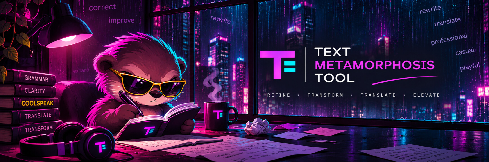
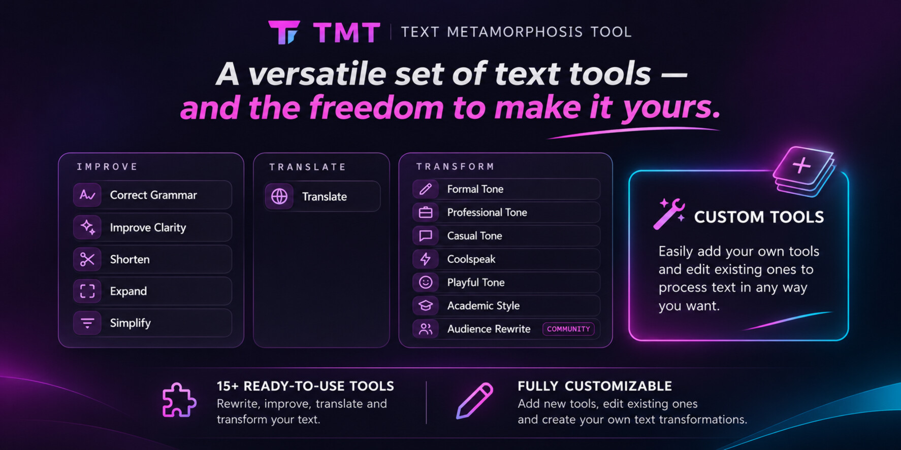
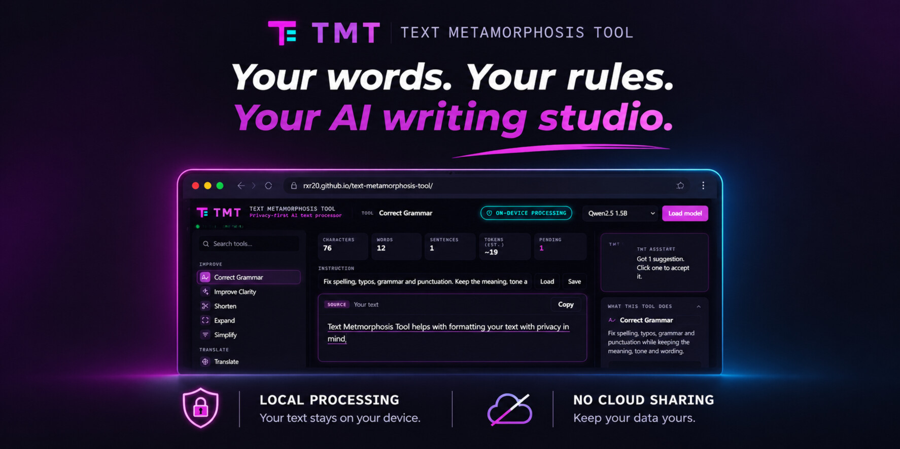

<div align="center">



# ✨ TMT · Text Metamorphosis Tool

**Your words. Your device. Your rules.**

A browser-based text workstation. Pick a tool, review sentence-level suggestions, and accept changes one by one or all at once.


</div>

---

## 🔒 Private by design

| | |
|---|---|
| 🧠 **On-device model** | Runs in your browser on your GPU through [WebLLM](https://github.com/mlc-ai/web-llm) and WebGPU. |
| 🚫 **No cloud AI** | Your text, prompts and suggestions are never sent to a cloud AI service. |
| 👤 **No accounts** | No backend, no analytics, no telemetry. |
| ⚠️ **Honest about the network** | The WebLLM runtime loads from a CDN, and model files download when you click *Load model*. TMT never falls back to remote inference. |

---

## ⚙️ How it works

1. **Choose a tool** in the sidebar. Search by name, description, tag, category or author.
2. **Load a model** from the header, then type or paste text.
3. **Review suggestions.** Each sentence is processed separately. Hover a changed sentence to highlight its match in the other panel.
4. **Accept** a suggestion by clicking it, or use **Approve all**. Copy the source, or copy the result with everything applied.



---

## 🧩 Features

| Feature | Details |
|---|---|
| 🔁 **Sentence-by-sentence** | Cached by model, instruction and sentence, with cancellation and debounce. |
| 🛠️ **12 built-in tools** | Grammar, clarity, shorten, expand, simplify, formal, professional, casual, coolspeak, playful, academic, translate. |
| ✏️ **Custom instruction** | Write your own transformation in plain language. |
| 🌍 **Translate** | Searchable, extensible target-language list. |
| 📊 **Live metrics** | Computed from your real text. Token count is an estimate (about 4 characters per token). |
| 🎞️ **Metamorphosis reveal** | Animated reveal on each suggestion, respecting `prefers-reduced-motion`. |
| 📱 **Responsive** | Desktop, tablet and mobile layouts. |



---

## 📋 Requirements

- **A modern browser** with WebGPU enabled.
- **Modern NVIDIA graphics card**, **8 GB VRAM recommended**. Smaller models run on less memory, with lower quality.
- An internet connection the first time, to download the runtime and the model you pick.

---

## 🚀 Run it

Pick one of the three options below.

### A. Download the latest release (recommended)

1. Go to the [latest release](https://github.com/rxr20/text-metamorphosis-tool/releases/latest).
2. Download the ZIP file and extract it.
3. Open the extracted folder and double-click `index.html`.

### B. Download the main branch

1. Go to the [main branch](https://github.com/rxr20/text-metamorphosis-tool/tree/main).
2. Click **Code → Download ZIP** and extract it.
3. Open the extracted folder and double-click `index.html`.

### C. Try it online

Open **[rxr20.github.io/text-metamorphosis-tool](https://rxr20.github.io/text-metamorphosis-tool/)** in your browser. Nothing to install.

> The model is still downloaded to your device, and your data is not processed online. Your text stays on your computer.

---

## 🤝 Contribute a tool

> **Have a text transformation idea?** Add a small definition, include an example, and open a pull request.

1. Copy `tools/community/example-tool.js` to `tools/community/your-tool-id.js`.
2. Edit the definition. See the [tool schema](docs/TOOL_SCHEMA.md).
3. Add the path to `tools/manifest.js`. The tool appears in the sidebar automatically.

Read [CONTRIBUTING.md](CONTRIBUTING.md) for the full process. Contributions are reviewed before merging.

⭐ If you find TMT useful, a star on GitHub helps others discover it.

---

## 🏗️ Architecture

```text
index.html            entry point (no build, classic scripts)
resources/
  registry.js         tool validation and loader (data only)
  script.js           UI, sentence engine, WebLLM flow, metamorphosis effect
  style.css           visual system
tools/
  manifest.js         list of tool files
  languages.js        target languages for Translate
  built-in/*.js       core tools
  community/*.js      contributed tools
docs/TOOL_SCHEMA.md   tool format
```

- Tool files call `TMT.registerTool({...})` and load as classic scripts, so everything works from `file://`.
- The registry validates each tool, skips bad ones with a console warning, and never runs contributor code.
- WebLLM is loaded from a CDN with `import()`. No model weights are hosted here.

---

## ⚠️ Known limitations

| Limitation | Why |
|---|---|
| Quality depends on the model | Tiny models make mistakes, especially in less common languages. |
| No cross-sentence context | Sentences are processed independently. |
| WebGPU only | Other browsers are not supported. |
| Large first load | The first model download can be big and slow. |

---

## 📜 License

Released under the [MIT License](LICENSE). Copyright (c) 2026 rxr.

---

## 🙏 Credits

- [WebLLM](https://github.com/mlc-ai/web-llm) for on-device inference.
- [Bootstrap](https://getbootstrap.com) and [jQuery](https://jquery.com), bundled in `resources/`.
- Flag emoji use the bundled `resources/TwemojiCountryFlags.woff2` (Twemoji graphics, CC-BY 4.0, via the MIT-licensed `country-flag-emoji-polyfill`).
